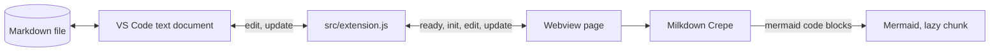

# Architecture

This page describes how NotionDown is built and why. Read the overview first, then the sections you need.

## Overview

NotionDown is a VS Code custom text editor for Markdown files. VS Code owns the file. A webview page owns the screen. The two exchange Markdown text and nothing else.

- **Host** (`src/extension.js`):
  - Registers the `notionDown.editor` custom editor and the `notionDown.openEditor` command.
  - Reads and writes the document through VS Code's own text model, so Save, undo, Git, and the dirty marker behave as for any file.
- **Page** (`src/webview/main.js`):
  - Runs Milkdown Crepe, which gives the Notion-style blocks, slash menu, drag handles, and table editing.
  - Renders Mermaid diagrams under code blocks.
- **Page shell** (`src/webview.html`):
  - A template that the host fills with a nonce and resource addresses.

## High-Level Architecture

- **Why a custom editor, not a preview panel:**
  - The page is the only view of the file, so there is no split screen and no scroll sync problem.
  - `priority: "option"` keeps the default text editor as the default. The user opts in per file with **Open in NotionDown** or **Reopen Editor With...**.
- **Why a local bundle, not a CDN:**
  - Milkdown has no CDN build, and a local bundle keeps remote script sources out of the Content Security Policy.
  - The cost is a larger `.vsix`. Mermaid and the CodeMirror languages load as lazy chunks, so the editor opens without parsing them.

## Message Protocol

| Message  | Direction    | Payload        | Meaning                                                                        |
| :------- | :----------- | :------------- | :----------------------------------------------------------------------------- |
| `ready`  | page to host | none           | The page script has loaded and can accept text.                                |
| `init`   | host to page | `text`         | The document text, with LF line endings. The page creates the editor from it.  |
| `edit`   | page to host | `text`         | The user changed the document. `text` is the full Markdown.                    |
| `update` | host to page | `text`         | The document changed from outside the page (another editor, undo, Git).        |

- **Full text, not patches:**
  - Markdown files are small, and a full-text message cannot drift out of sync.
- **Validation:**
  - The host acts only when `type` is a string and `text` is a string.

## State Management

- **Host, per editor:**
  - `pendingEchoes` holds the texts the host wrote and has not yet seen reported. A change event whose text is in the set is the host's own write and is not sent back.
  - `writeQueue` applies the page's edits in arrival order.
  - Disposing the panel disposes both subscriptions.
- **Page:**
  - `baseline` is the page's own serialization of the text the host holds. An editor event equal to `baseline` carries no user change and is not sent. Opening a file therefore never rewrites it.
  - Edits are sent 200 ms after the last keystroke, and at once when the tab hides.
- **Line endings:**
  - The page works in LF. The host converts to the document's own ending when it writes and compares in LF.

## Content Fidelity

- **What the file keeps:**
  - Text, structure, code fences, tables, task lists, links, and raw HTML are written back as Markdown.
- **What the first edit normalizes:**
  - The serializer writes `-` list markers and a `---` rule, to match the usual style. Table columns are padded to equal width.
  - Other style choices in the original file, such as `*` bullets or `***` rules, change on the first edit. The change is limited to the edited file.
- **What is not supported:**
  - Math (`$...$`) shows as text. The Crepe math feature is off.
  - Image insertion is off. Images that the Markdown already references load through the page's `<base>` address.

## Security Model

The page renders untrusted Markdown, including raw HTML and diagram text, so the controls overlap.

### Layer 1: Content Security Policy with a nonce

- **Scripts:**
  - `script-src` allows only the per-render nonce. No remote script source and no `unsafe-eval` are allowed.
  - The host creates the nonce with `crypto.randomBytes` for each editor.
- **Connections:**
  - `default-src 'none'` blocks `fetch`, WebSocket, and frames. The harness shows the block in the console.
- **Styles:**
  - `style-src` allows `unsafe-inline` because Mermaid and ProseMirror write inline styles. Scripts stay nonce-only, so inline styles cannot run code.
- **Images:**
  - `img-src` allows the extension's own resources, `https`, `data`, and `blob`. A document that links a remote image makes the page fetch it.

### Layer 2: Escaping of the page template

- **Template values:**
  - `buildHtml` escapes every value it inserts, because file paths reach the `<base>` and script addresses.
  - A missing value throws, so a typo cannot ship a literal placeholder.

### Layer 3: Mermaid strict mode

- **Setting:**
  - Mermaid runs with `securityLevel: "strict"`, which sanitizes labels and disables click handlers.
- **Failure:**
  - An invalid diagram shows an error note in place of the preview.

### Layer 4: Resource roots

- **Roots:**
  - The page can read only `dist`, the document's folder, and the workspace folders.

### Layer 5: Workspace Trust

- **Support:**
  - `capabilities.untrustedWorkspaces.supported` is `true`. The extension runs no workspace code, and the page reads only the roots above.

## Build

- **Two bundles:**
  - `dist/extension.js` for the host (Node, CommonJS) and `dist/webview/` for the page (browser, with CSS and lazy chunks).
- **Run-time public path:**
  - `main.js` sets `__webpack_public_path__` and `__webpack_nonce__` from its own `<script>` tag before any lazy import, so chunk scripts load from the extension folder and carry the nonce.
- **Crepe styles:**
  - Crepe marks its package side-effect free, so webpack drops its CSS imports unless the CSS rule sets `sideEffects: true`. A bundle test checks the result.

## Guidelines for Future Changes

### Safe to Modify

- **Theme:**
  - `src/webview/theme.css`, within the VS Code variables it maps.
- **Crepe features:**
  - Turning a Crepe feature on or off in `src/webview/main.js`. Check the CSS imports and the bundle size after.
- **Tests and documents.**

### Requires Security Review

- **CSP and template:**
  - Any change to the policy in `src/webview.html`, `buildHtml`, or the nonce.
- **Messages:**
  - A new message type, or any use of message contents beyond writing them as document text.
- **Files:**
  - `localResourceRoots`, `<base>`, or `img-src`.
- **Mermaid:**
  - Its `securityLevel` or any code that inserts its output.
