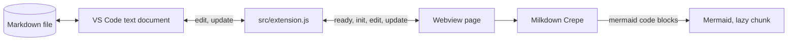

# Architecture

This page describes how NotionDown is built and why. Read the overview first, then the sections you need.

## Overview

NotionDown is a VS Code custom text editor for Markdown files. Two parts share the work, and they exchange Markdown text and nothing else.

- **Ownership:**
  - VS Code owns the file.
  - A webview page owns the screen.

- **Host** (`src/extension.js`):
  - Registers the `notionDown.editor` custom editor and the `notionDown.openEditor` command.
  - Reads and writes the document through VS Code's own text model, so Save, undo, Git, and the dirty marker behave as for any file.
- **Page** (`src/webview/main.js`):
  - Runs Milkdown Crepe, which gives the Notion-style blocks, slash menu, drag handles, and table editing.
  - Renders Mermaid diagrams under code blocks.
- **Page shell** (`src/webview.html`):
  - A template that the host fills with a nonce and resource addresses.

## High-Level Architecture

- **Why a custom editor, not a preview panel:**
  - The page is the only view of the file, so there is no split screen and no scroll sync problem.
  - `priority: "default"` makes NotionDown open every `.md` file as soon as it installs, which is the product's purpose.
- **Opting out:**
  - VS Code's own `workbench.editorAssociations` is the one place a user overrides a default, so the extension adds no setting of its own that would have to fight it.
  - **Use the VS Code Text Editor as the Default Markdown Editor** writes `"*.md": "default"` to the user setting, and **Use NotionDown as the Default Markdown Editor** removes that entry. Neither touches an entry that belongs to another editor, and neither copies workspace settings into the user setting.
- **Why a local bundle, not a CDN:**
  - Milkdown has no CDN build, and a local bundle keeps remote script sources out of the Content Security Policy.
  - The cost is a larger `.vsix`. Mermaid and the CodeMirror languages load as lazy chunks, so the editor opens without parsing them.

## Message Protocol

| Message  | Direction    | Payload        | Meaning                                                                        |
| :------- | :----------- | :------------- | :----------------------------------------------------------------------------- |
| `ready`  | page to host | none           | The page script has loaded and can accept text.                                |
| `init`   | host to page | `text`         | The document text, with LF line endings. The page creates the editor from it.  |
| `edit`   | page to host | `text`         | The user changed the document. `text` is the full Markdown.                    |
| `update` | host to page | `text`         | The document changed from outside the page (another editor, undo, Git).        |

- **Full text, not patches:**
  - Markdown files are small, and a full-text message cannot drift out of sync.
- **Validation:**
  - The host acts only when `type` is a string and `text` is a string.

## State Management

- **Host, per editor:**
  - `pendingEchoes` holds the texts the host wrote and has not yet seen reported. A change event whose text is in the set is the host's own write and is not sent back.
  - `writeQueue` applies the page's edits in arrival order.
  - Disposing the panel disposes both subscriptions.
- **Page:**
  - `hostText` is the file text the host holds. After each edit, the page builds the new file text from `hostText` and the editor's output, as the Content Fidelity section describes, and sends it only when it differs from `hostText`. Opening a file therefore never rewrites it.
  - Edits are sent after a pause in typing, and at once when the tab hides. [Cost](#cost) gives the delay.
- **Line endings:**
  - The page works in LF. The host converts to the document's own ending when it writes and compares in LF.

## Content Fidelity

A block editor re-serializes the document in its own style. Writing that output back would change lines the user never touched. `src/markdown-sync.js` prevents that.

- **Rule:**
  - A top-level block that the user did not change keeps its exact original text, including its blank lines, list markers, and escapes.
- **How the page knows a block did not change:**
  - It serializes each original block through the same editor pipeline and compares the result with the editor's output, block by block.
  - The comparison ignores two serializer habits that are not edits: ` ` for an empty paragraph, and swapping `-` for `*` between adjacent lists.
  - Link definitions travel with every block, because the editor resolves a reference link only beside its definition.
- **What changes in the file:**
  - A block the user edited is written in the editor's style: `-` bullets, a `---` rule, padded tables, and escapes where Markdown needs them.
  - A block the user moved keeps its original text.
  - Empty paragraphs the user adds are not written. Empty paragraphs the file already has at its start or end stay.
- **Front matter:**
  - A leading `---` block is kept out of the editor and written back unchanged.
- **What the editor shows, not what the file keeps:**
  - Math renders with KaTeX. Remark-math pairs any two dollar signs in a paragraph, so two prices can display as math. The file text is not affected.
  - Images written as `` display, and the path resolves through the page's `<base>`. Inserting, pasting, or dragging an image is off by decision (see [decisions.md](decisions.md)).
  - Raw HTML shows as text and never runs.
  - Syntax that Milkdown does not know, such as footnotes, shows as text. The file keeps it while the block stays unchanged, and an edit to that block may rewrite it.
- **Limits:**
  - Two edits in the same block rewrite the whole block, not just the changed words.
  - An empty list item the user adds is written as a bare marker (`-`), and other empty-paragraph placeholders inside an edited block are removed.

### Cost

- **When it runs:**
  - After the user stops typing, not on every keystroke and not on save. VS Code saves the buffer to disk by its own rules.
  - The delay is 200 ms, and it grows to four times the last run's duration, up to 2 seconds, so a very large file never spends more than about a fifth of the time here.
- **What it costs:**
  - The page serializes the document and parses it into blocks (two passes over the text), then compares block keys. Original blocks are serialized once and cached by text.
  - Measured under jsdom on generated files: 200 blocks (8 KB) takes about 30 ms, 1,000 blocks (41 KB) about 115 ms, and 3,000 blocks (126 KB) about 430 ms. The first run after opening costs two to three times as much, so the page does it at idle, 500 ms after the file opens.

## Security Model

The page renders untrusted Markdown, including raw HTML and diagram text, so the controls overlap.

### Layer 1: Content Security Policy with a nonce

- **Scripts:**
  - `script-src` allows only the per-render nonce. No remote script source and no `unsafe-eval` are allowed.
  - The host creates the nonce with `crypto.randomBytes` for each editor.
- **Connections:**
  - `default-src 'none'` blocks `fetch`, WebSocket, and frames. The harness shows the block in the console.
- **Styles:**
  - `style-src` allows `unsafe-inline` because Mermaid and ProseMirror write inline styles. Scripts stay nonce-only, so inline styles cannot run code.
- **Images:**
  - `img-src` allows the extension's own resources, `https`, `data`, and `blob`. A document that links a remote image makes the page fetch it.

### Layer 2: Escaping of the page template

- **Template values:**
  - `buildHtml` escapes every value it inserts, because file paths reach the `<base>` and script addresses.
  - A missing value throws, so a typo cannot ship a literal placeholder.

### Layer 3: Mermaid strict mode

- **Setting:**
  - Mermaid runs with `securityLevel: "strict"`, which sanitizes labels and disables click handlers.
- **Failure:**
  - An invalid diagram shows an error note in place of the preview.

### Layer 4: Resource roots

- **Roots:**
  - The page can read only `dist`, the document's folder, and the workspace folders.

### Layer 5: Workspace Trust

- **Support:**
  - `capabilities.untrustedWorkspaces.supported` is `true`. The extension runs no workspace code, and the page reads only the roots above.

## Build

- **Two bundles:**
  - `dist/extension.js` for the host (Node, CommonJS) and `dist/webview/` for the page (browser, with CSS and lazy chunks).
- **Run-time public path:**
  - `main.js` sets `__webpack_public_path__` and `__webpack_nonce__` from its own `<script>` tag before any lazy import, so chunk scripts load from the extension folder and carry the nonce.
- **Crepe styles:**
  - Crepe marks its package side-effect free, so webpack drops its CSS imports unless the CSS rule sets `sideEffects: true`. A bundle test checks the result.

## Guidelines for Future Changes

### Safe to Modify

- **Theme:**
  - `src/webview/theme.css`, within the VS Code variables it maps.
- **Crepe features:**
  - Turning a Crepe feature on or off in `src/webview/main.js`. Check the CSS imports and the bundle size after.
- **Tests and documents.**

### Requires Security Review

- **CSP and template:**
  - Any change to the policy in `src/webview.html`, `buildHtml`, or the nonce.
- **Messages:**
  - A new message type, or any use of message contents beyond writing them as document text.
- **Files:**
  - `localResourceRoots`, `<base>`, or `img-src`.
- **Mermaid:**
  - Its `securityLevel` or any code that inserts its output.
