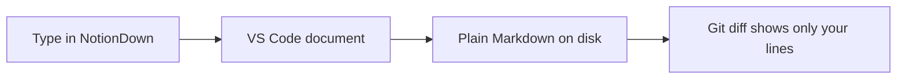

# Project notes

NotionDown turns a Markdown file into a page you edit in place. Type `/` for blocks, drag the handle to reorder them, and the file on disk stays plain Markdown.

## This week

- [x] Draft the outline
- [x] Pick the diagram style
- [ ] Review the notes with the team

## How a note travels



## Math

The energy of a particle is $E = mc^2$, and the area under a parabola is

$$
\int_0^1 x^2 \, dx = \frac{1}{3}
$$

## Code

```python
def greet(name: str) -> str:
    return f"Hello, {name}"

print(greet("NotionDown"))
```

## Choosing a format

| Format   | Editable in place | Plain text on disk |
| :------- | :---------------: | :----------------: |
| NotionDown | yes             | yes                |
| Word file  | yes             | no                 |

> A note you can read in any editor is a note you keep.
