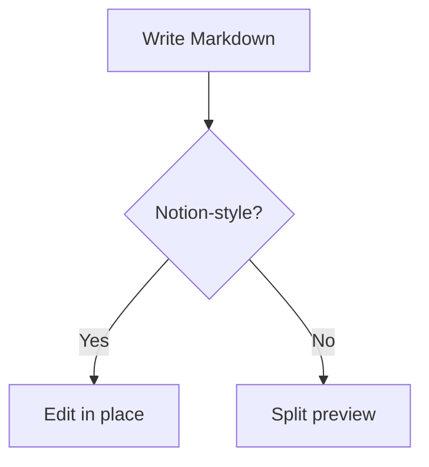

# NotionDown sample

A paragraph with **bold**, _italic_, `inline code`, ~~strikethrough~~, and a [link](https://example.com).

## Lists

- Bullet one
- Bullet two
  - Nested bullet

1. First
2. Second

- [ ] Open task
- [x] Done task

## Table

| Tool     | Purpose           |
| :------- | :---------------- |
| Milkdown | Editor core       |
| Mermaid  | Diagrams          |

## Code

```js
function greet(name) {
	return `Hello, ${name}`;
}
```

## Mermaid



## Quote and divider

> A block quote.

---

Text with <b>raw HTML</b> and a $dollar$ sign.
